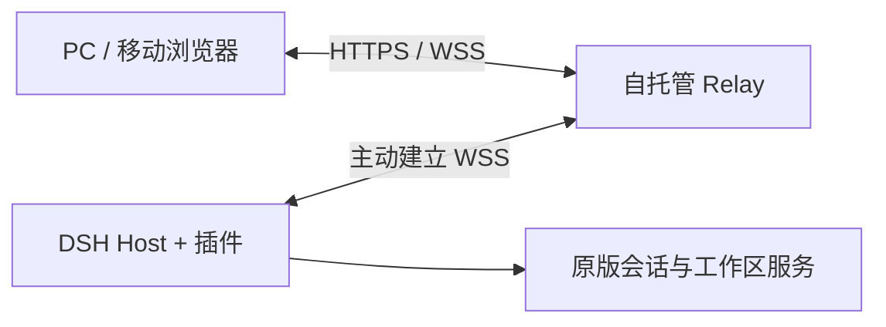

# DSH Web Control

[English](README.en.md) · [安装](docs/installation.md) · [部署 Relay](docs/deployment.md) · [版本与限制](docs/compatibility.md) · [Releases](https://github.com/liangkw16/dsh-web-control/releases)

通过链接或二维码，在电脑、平板和手机浏览器中接管正在运行的 DeepSeek Harness 会话。

**尽可能复用 DSH 原版 Web UI，Web Control 只负责认证、连接与有限能力桥接。** 无需开放电脑的入站端口，无需远程桌面。

这是独立社区插件，与 DeepSeek 没有隶属或官方背书关系。当前版本 **v0.1.0**，验证目标为 **DSH 0.2.0-rc.2**；其他 DSH 版本未声明兼容。Relay 需自行部署，本项目不提供公共托管服务。

## 能做什么

- 原版会话列表、消息、执行进度、工具记录、队列操作和审批交互。
- 在电脑与移动浏览器间切换，新页面可接替旧控制页面。
- 原版文件卡片、历史 diff、侧栏标签和完整文件预览；支持浏览器下载与上传。
- 插件在 DSH Host 中保持连接，关闭设置页面或仅锁屏后仍可使用；休眠、断网和退出 DSH 会影响连接。
- 通过版本协商和明确的命令接口适配，保留 DSH 原版业务资源，避免维护另一套聊天界面。

## 工作方式



Relay 负责认证、路由和静态 UI 分发。浏览器与 Host 均通过 TLS 连接到 Relay，**不是端到端加密**：部署者必须信任自己的 Relay。控制链接是访问凭据，不要公开分享。

## 快速开始

1. 从 [v0.1.0 Release](https://github.com/liangkw16/dsh-web-control/releases/tag/v0.1.0) 下载插件 `dsh-web-control-0.1.0.tgz`、部署包及 `SHA256SUMS`，按[部署指南](docs/deployment.md)启动 HTTPS Relay。
2. 在 DSH 桌面 App 的「插件 → 添加插件」中安装下载的 `.tgz`，启用插件。CLI 用户可运行：

   ```sh
   npx @deepseek-ai/dsh@0.2.0-rc.2 plugin --profile web add ./dsh-web-control-0.1.0.tgz
   ```

3. 首次使用时，由 Relay 管理者生成一次私有连接配置，在 DSH「设置 → 网页远控」导入；日常使用只需打开生成的链接或扫码。
4. 保持 DSH 运行，在另一台设备的浏览器打开链接即可。停止远控、刷新链接与接管规则见[安装指南](docs/installation.md)。

预构建 tarball 不需要在安装时执行构建脚本。源码仓库是 monorepo；不要把仓库根目录当成可直接安装的插件包。

## 文档

| 文档 | 内容 |
| --- | --- |
| [安装与配对](docs/installation.md) | 桌面 / CLI、首次配置、控制链接、升级卸载 |
| [Relay 部署](docs/deployment.md) | Docker Compose、HTTPS、IP:port、备份回退 |
| [架构](docs/architecture.md) | 原版 UI 复用、状态同步和权限边界 |
| [兼容性](docs/compatibility.md) | 支持范围、文件限制、浏览器验收边界 |
| [排障](docs/troubleshooting.md) | 连接、证书、文件读取与锁屏 |
| [贡献指南](CONTRIBUTING.md) | 构建、测试、PR 要求 |
| [发布流程](docs/releasing.md) | 制品、校验、验证与官方发现入口 |
| [安全政策](SECURITY.md) | 威胁模型、漏洞报告、凭据保护 |

## 本地开发

需要 Node.js 24.x、pnpm 11.25.0。运行测试只使用隔离 fixture，不连接你的生产 DSH。

```sh
corepack enable
corepack prepare pnpm@11.25.0 --activate
pnpm install --frozen-lockfile
pnpm build
pnpm typecheck
pnpm test
```

Relay 镜像还需要固定的原版 UI 资源；不能只运行 `docker build`。使用完整部署包，或按[发布流程](docs/releasing.md)组装 `release-input/web`。

## 许可证与来源

本项目使用 [MIT](LICENSE)。DeepSeek Harness 和其他依赖保留各自许可证，见 [THIRD_PARTY_NOTICES.md](THIRD_PARTY_NOTICES.md)。原版 UI 资源的许可证随部署包分发。

DeepSeek [官网](https://deepseek.com/harness/)的“社区插件”指向 GitHub [`dsh-plugin` topic](https://github.com/topics/dsh-plugin)，这是本项目采用的官方发现路径；不是“官方审核通过”的标志。
